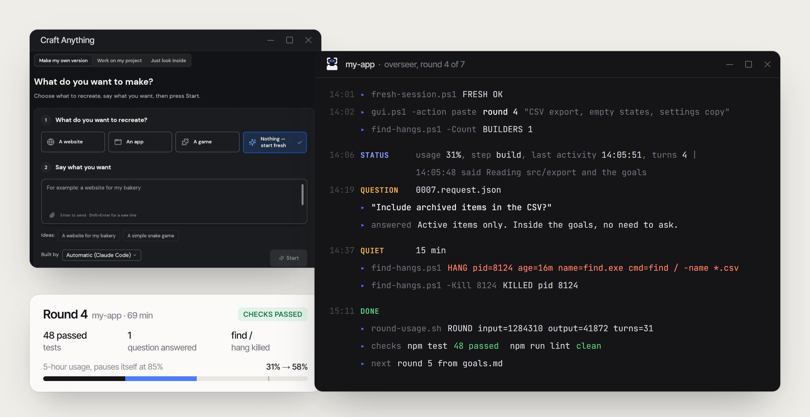

<p align="center">
  <picture>
    <source media="(prefers-color-scheme: dark)" srcset="assets/logo-dark.svg">
    <source media="(prefers-color-scheme: light)" srcset="assets/logo-light.svg">
    
  </picture>
</p>

<p align="center">
  A Claude Code plugin that watches and steers the Craft Anything desktop app while its builder rebuilds your app, round after round.
</p>

<p align="center">
  <a href="https://github.com/t1mvdploeg/craft-anything-overseer/actions/workflows/test.yml"></a>
  
  
  
</p>



*Illustration with fictional data.*

[Craft Anything](https://github.com/storytold/craft-anything) (CA) rebuilds an app with its own `claude` builder session. Left alone, one conversation grows until every turn is expensive, builds hang on a runaway command, and the usage limit stops the run at a bad moment. The overseer is a second Claude Code session that sends the rounds, watches, unblocks and checks the result.

## Quick start

In Claude Code:

```
/plugin marketplace add t1mvdploeg/craft-anything-overseer
/plugin install craft-anything-overseer@craft-anything-overseer
```

1. In your working folder, copy `skills/craft-anything-overseer/craft-overseer.example.json` to `craft-overseer.json` and fill in your project (`projectDir` such as `%USERPROFILE%\Documents\Craft Anything\my-app`, a goals file, your `checks` such as `npm test`).
2. **In Craft Anything, set the builder's approvals to Allow** for the project: click **Approvals** (right under the chat input), set every row (Reading the web, Other commands, Files outside the project, Pushing and publishing, Deleting outside the project, System changes, Other tools) to **Allow**. It is stored per project in `craft.json` (`"approvals"`). Without it the builder stops at a "May I allow ...?" card (status *Needs you*) and waits: the overseer never clicks Approvals, so the round stalls until you answer. Through `craft-anything-cli` an unanswered approval is declined at once. Allow means the builder runs commands and changes things outside the project without asking: only do this for projects you trust.
3. Optional, for usage-aware pausing: add `statusline/write-usage.sh` to your Claude Code statusline. It writes the rate limits to `~/.claude/usage-limits.json` (the `usageFile` setting). Without that file usage shows as `?` and nothing pauses.
4. Say "watch Craft Anything" or type `/craft-anything-overseer`.

Needs Windows, PowerShell 7, Git Bash and `jq`.

**macOS**: needs `jq` and, for the GUI, `brew install cliclick` plus Accessibility and Screen Recording for the app that runs Claude Code. Copy `craft-overseer.macos.example.json` instead. Scripts are in `skills/craft-anything-overseer/macos/` (`find-hangs.sh`, `fresh-session.sh`, `gui.sh`); `watch.sh` picks them up on its own. Rounds can also go through `craft-anything-cli rebuild --continue-in` without clicking. Tests: `bash tests/macos.test.sh`. Not live-proven on a real round yet.

## What it does

- Sends each round into a **fresh builder conversation** with a frugal workflow, so context never piles up.
- **Monitors** the run and reports one tagged line per event.
- **Kills hangs** (an endless `find /`, a runaway `ffmpeg`, a blind sleep loop) and nudges a builder that went quiet.
- **Pauses at your usage threshold** and resumes after the reset.
- **Answers builder questions** that are technical; asks you about product decisions.
- **Checks each round**: runs your `checks`, takes screenshots, reports, and keeps a handoff file current.

## How it works

The skill drives small scripts. It never writes into your app folder during a round.

| Script | Job |
| --- | --- |
| `monitor/watch.sh` | Tails the build log and prints tagged events |
| `monitor/round-usage.sh` | Sums builder input and output tokens for one round |
| `windows/find-hangs.ps1` | Lists, counts or kills (suspects only) hung builder processes |
| `windows/fresh-session.ps1` | Closes CA, clears the builder session, restarts CA |
| `windows/gui.ps1` | Screenshot, paste and click in the CA window |
| `windows/close-console-windows.ps1` | Closes console windows that pile up |

| Tag from `watch.sh` | Meaning |
| --- | --- |
| `DONE` | The round ended |
| `QUESTION <file>` | The builder asks something |
| `QUIET <n> min` | Watchdog: nothing happened for a while |
| `FAIL 5x in a row` | Five failed commands in a row |
| `USAGE <u>% >= <th>%: pause` | Usage threshold reached |
| `STATUS ...` | Step, usage, last activity (information only) |

Optional relay: set `relay` in your settings with an `arm` command, a `go` command containing `{handoff}`, and a `percent`. The overseer then writes a handoff and hands over to a fresh session when its own context fills. Without `relay` nothing is called; the handoff is updated after every round instead.

## Numbers

In one long rebuild, sending each round to a fresh builder conversation with a frugal workflow cut the builder's main-agent input from 44.6M tokens (one round, one long conversation) to 3.6-5.4M per round over three later rounds; measured from Craft Anything's build log ('turn ended (N tokens in)'). One project, one person. Subagent tokens are not counted in this figure, so total usage drops less than it suggests.

## What it does not do

- Windows and macOS. The GUI scripts need an unlocked, awake screen.
- Not live-proven yet: the builder process match and a real close and restart of CA. The skill checks both on the first live round.
- The relay needs your own relay command; none is included.
- It does not decide what to build: you approve a goals list, it works through it.

## Known Craft Anything issues it works around

Bugs filed upstream (#2428-#2435) are worked around rather than waited for. Symptoms and fixes are in `skills/craft-anything-overseer/references/pitfalls.md`.

## Licence

MIT
